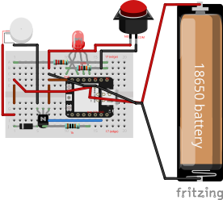

[English](README.md) | **日本語**

# 概要

#### デバイスには4つのモードがあります：アクティブ、通常チェック、低頻度チェック、オフ。
- ネットワークと MQTT に接続すると通常モードで動作し、15秒ごとに起動してコマンドを確認します。
- コマンドを受け取るとアクティブになり、2分間起きたままになります。このモードではメッセージを即座に受信できます。
- 2日間操作がないと低頻度モードになり、30秒ごとにしか確認しなくなります（これらの値は設定で変更できます）。
- コマンド `off` を送ると、デバイスはディープスリープに入り、ボタンでしか起動できなくなります。

#### LED の色
- 赤：WiFi に接続中
- 青：MQTT に接続中
- 緑：アクティブ
- 黄：両方のデバイスがアクティブ
- 白：このデバイスが振動中
- マゼンタ：相手のデバイスが振動中
- シアン：振動コマンドを送信中（相手のデバイスがまもなく起動するはずです）

#### WiFi
ESP32 は WiFi 経由で MQTT を使って通信します。デフォルトの WiFi ネットワークがコードに直接書き込まれており、最初の起動時に自動的にそのネットワークへの接続を試みます。ネットワークは、シリアルターミナルまたは MQTT コマンドで設定に追加できます。新しいネットワークに接続すると、デフォルトのネットワークがそのネットワークに変わります。デバイスは最後に接続したネットワークへの接続を2回試みます。2回とも失敗した場合は、設定に保存されているほかのネットワークをすべて試します。新しいネットワークに接続できた場合は、そのネットワークをリストの先頭に移動し、最後に接続したネットワークとして記録します。この処理を3回繰り返しても接続できなければ、低頻度チェック間隔の2倍（60秒）スリープしてから再試行します。どのネットワークにも接続できない場合は、デバイスをパソコンにつなぎ、[Arduino IDE](https://www.arduino.cc/en/software/) からネットワークを追加するコマンドを送る必要があります。

#### MQTT
MQTT サーバーへの接続中（メッセージを送信できない間）は、LED がデバイスの状態を表示します。WiFi に接続中は赤、MQTT に接続中は青に光ります。MQTT への接続に2回失敗すると、低頻度チェック間隔の2倍（60秒）スリープしてから再試行します。ボタンを押すと、すぐに再接続を試みます。

#### ボタン
接続中にボタンを押すと、相手のデバイスのモーターが20%の強さで動きます（変更可能）。ボタンを10秒以上押し続けると、モーターは自動的に止まります。

#### バッテリー
バッテリーはデバイスを電源につなぐと充電でき、電圧は MQTT の info トピックで確認できます。1日あたりアクティブ1時間・通常チェック23時間の場合、バッテリーは約20日もつと見積もっています。また、電圧が3.3Vになるとバッテリー切れが近いと見ています。

# MQTT ブローカーの設定
MQTT ブローカーを自分でホストしたくない場合は、[EMQX](https://www.emqx.com/en/MQTT/public-MQTT5-broker) というサービスをおすすめします。無料プランでは、1,000台のデバイスを接続でき、毎月100万分のアクティブ時間と1GBのデータ通信が使えます。このプロジェクトには十分すぎるほどです。アカウントを作成してプロジェクトを作り、`Access Control->Authorization` でユーザー名とパスワードを設定すれば（このコードでそのまま動くよう、両方とも `a` にしてください）、`Deployment Overview` で MQTT ホストを確認できます。そのホストの URL を `LDP-ESP32-Code.ino` ファイルの上のほうに設定してください。

例：`const char* defaultMqttHost = "lc600a99.ala.us-east-1.emqxsl.com"`


# コマンドの送信：
コマンドは `IoT MQTT Panel` アプリからデバイスに送れます。各デバイスの状態も確認でき、モード、振動したとき、現在の電圧についてのメッセージが表示されます。

ダッシュボードの設定には次の項目が必要です：
- 名前（何でも可）
- ID（何でも可）
- ブローカーのアドレス（例）：`lc600a99.ala.us-east-1.emqxsl.com`
- ポート：`8883`
- ネットワークプロトコル：TCP-SSL
- 追加オプションのユーザー名：`a`
- パスワード：`a`
  
接続したら、パネルを5つ追加します。使えるトピックは `ESP32_1`、`ESP32_2`、`info` です。ESP32_1 と ESP32_2 にはそれぞれテキスト入力とテキスト出力を、info にはテキスト出力を追加してください。

# コマンド一覧
iOS または Android の IoT MQTT Panel アプリを開いて MQTT でコマンドを送るか、Arduino IDE のシリアルモニターからコマンドを送ります。

`run` - モーターをオンにします

`run 100` - モーターを100%の強さでオンにします

`stop` - モーターをオフにします

`print config` - 設定をターミナルに表示します

`config [key] [value]`（例：`config strength 100`）- 設定の項目の値を変更します

`delete config` - 設定を削除し、デフォルト値で作り直します

`add network [name] [password]` - 名前（SSID）とパスワードを指定してネットワークを追加します

`delete network [ssid]` - 指定した名前（SSID）の WiFi ネットワークを削除します

`print voltage` - 電圧をターミナルと MQTT の info トピックに表示します

`sleep` - デバイスをスリープさせます。通常チェックの時間が来ると起動します

`off` - デバイスをスリープさせます。ボタンでしか起動できません（作業中）

`var all` - グローバル変数の値を表示します（デバッグ用）

デバイスが MQTT に接続しようとしている間は、コマンドを送るまで少し待つ必要がある場合があります。

# 製作メモ
- このプロジェクトを作るときは、下の部品リストと、このリポジトリの `LDP-Wiring.svg` ファイルを参考にしてください。完成後のケースとして 3D プリントできる 3D モデルファイル `LDP-housing-model.stl` もあります。
- [ESP32 XIAO C3 についての情報](https://wiki.seeedstudio.com/XIAO_ESP32C3_Getting_Started/)
- LED にはピン D9（GPIO21）と D7（GPIO20）は使えません。スリープ中にオフにできず、LED がうっすら光ってしまうためです。
- LED にはピン同士が触れないようにテープを貼っています。必須ではなく、ピン同士が触れないようにできれば何でも構いません。
- ESP32 のバッテリー用の線は、すべて USB ポートとは反対側の背面から引き出してください。BAT-/BAT+ パッドには2組の線をつなぎます。1組はバッテリーホルダーへ、もう1組はボードに給電するジャンパー線です。（[こちらの説明](https://wiki.seeedstudio.com/XIAO_ESP32C3_Getting_Started/#check-the-battery-voltage)のように、パッドにもう1組の220kΩ抵抗をはんだ付けすれば、写真のように220kΩ抵抗を取り付ける必要はありません。）
  


# 配線の写真


残念ながら、これらの例でははんだ付けを2か所間違えています。代わりに Fritzing のモデルを参考にしてください。青と紫の線は不要で、ESP32 の BAT+/BAT- パッドにつなぐジャンパー線は1組だけで足ります。また、この例では ESP32 のヘッダーピンが曲がってしまっています。


# 部品リスト
[Seeed ESP32 XIAO C3](https://www.amazon.com/dp/B0DGX3LSC7/?coliid=I2IC5EZRWAHNOI&colid=PV7PKK8FXEMM&psc=1&ref_=list_c_wl_lv_ov_lig_dp_it)

[8000-16000RPM モーター](https://www.amazon.com/dp/B07KYLZC1S/?coliid=I126MR9PDJDCQ6&colid=PV7PKK8FXEMM&psc=0&ref_=list_c_wl_lv_ov_lig_dp_it)

[2インチ アーケードボタン](https://www.amazon.com/dp/B07V55YPP3/?coliid=IDG3NBFSIP9FQ&colid=PV7PKK8FXEMM&psc=0&ref_=list_c_wl_lv_ov_lig_dp_it)

[18650 充電式バッテリー](https://www.amazon.com/dp/B0DF6CPJFR/?coliid=I2VGGUA3UJVIOO&colid=PV7PKK8FXEMM&psc=1&ref_=list_c_wl_lv_ov_lig_dp_it)

[18650 バッテリーホルダー](https://www.amazon.com/dp/B0BJV7SK5D/?coliid=I313229R87YLUP&colid=PV7PKK8FXEMM&psc=1&ref_=list_c_wl_lv_ov_lig_dp_it)

[カソードコモン RGB LED](https://www.amazon.com/dp/B077XGF3YR/?coliid=I13QFMGDXI117R&colid=PV7PKK8FXEMM&psc=1&ref_=list_c_wl_lv_ov_lig_dp_it)

[ミニブレッドボード](https://www.amazon.com/dp/B09YXQJMTG/?coliid=I2YQE37EN4FBCN&colid=PV7PKK8FXEMM&psc=1&ref_=list_c_wl_lv_ov_lig_dp_it)

[耐熱ポリイミドテープ](https://www.amazon.com/dp/B0DZCTB4KG?ref=ppx_yo2ov_dt_b_fed_asin_title&th=1)

[2N2222 トランジスタ](https://www.amazon.com/dp/B07T61SY9Y/?coliid=I3PYCMWC9PFVFN&colid=PV7PKK8FXEMM&psc=1&ref_=list_c_wl_lv_ov_lig_dp_it)

[ダイオード](https://www.amazon.com/dp/B0FC2CTBJR/?coliid=I1ROCEWO08S2PZ&colid=PV7PKK8FXEMM&psc=1&ref_=list_c_wl_lv_ov_lig_dp_it)

[ブレッドボード用ジャンパー線キット](https://a.co/d/aZJ2nzj)

[抵抗](https://www.amazon.com/dp/B0F4P352BB/?coliid=I1F8ZJCRO5PW9O&colid=PV7PKK8FXEMM&psc=1&ref_=list_c_wl_lv_ov_lig_dp_it)

[ヘッダーピン](https://www.amazon.com/dp/B07PKKY8BX/?coliid=INKQMG3MK3TDR&colid=PV7PKK8FXEMM&psc=1&ref_=list_c_wl_lv_ov_lig_dp_it)

# （作業中）公共ネットワークでブロックされる場合の対処
これは自分用のメモで、この方法はまだコードに実装されていません。一部の公共 WiFi では `emqxsl.com` というホストがブロックされていて、そのネットワークでは MQTT メッセージを送れません。私の大学のキャンパス WiFi がそうです。これは、コマンドを受け取って EMQX に転送する Web サービスをホストすれば回避できます。そのためのサービスとしては [Render.com](https://render.com/) をおすすめします。
- この GitHub リポジトリをクローンします
- `Projects` を開きます
- `Deploy A Web Service` を選びます
- このリポジトリを選択します
- `Language` を `Node` に設定します
- `Root Directory` を `./Optional-MQTT-Bridge` に設定します
- `Build Command` を `npm install` に設定します
- `Start Command` を `npm start` に設定します

これで、Web サービスのリンク `https://example.onrender.com` を使って MQTT ブローカーにメッセージを送れます。ESP32 からは次のように送信できます：
```
http.begin(client, "https://example.onrender.com/publish");
http.addHeader("Content-Type", "application/json");
http.POST("{\"topic\":\"example_topic\",\"message\":\"hello\"}");
```

コマンドラインからは次のように送れます：

`curl -X POST https://long-distance-plushie.onrender.com/publish -H "Content-Type: application/json" -d '{"topic": "example_topic", "message": "hello"}'`

ただし、私の大学のネットワークでは、HTTPS でリクエストを送るとログイン用のキャプティブポータルも表示されます。ESP32 でこのログインポータルを通過する方法はわからないので、回避策の一つとして MAC アドレスの偽装があります。パソコンの MAC アドレスを変更して WiFi の認証を済ませ、ESP32 の MAC アドレスをそれに合わせてから、パソコンの MAC アドレスを元に戻します。同じネットワーク上に同じ MAC アドレスのデバイスが2台あってはいけません。コードに、常にブリッジを使うよう切り替えるフラグと、MAC アドレスを保存する変数を追加することもできます。今のところ実装する予定はなく、代わりにテザリングを使って試してみるつもりです。
